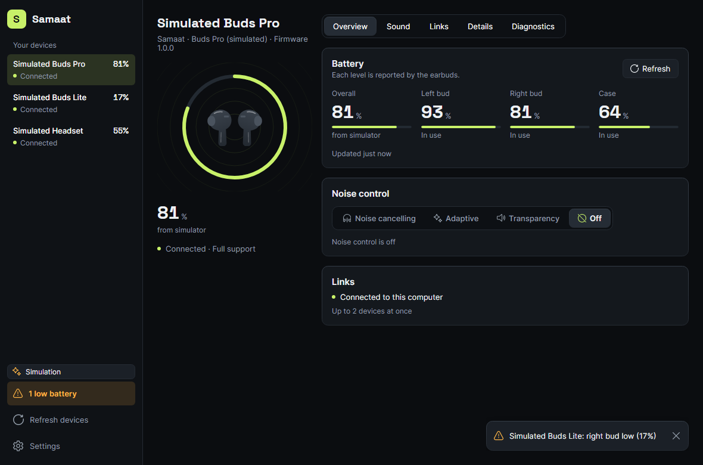
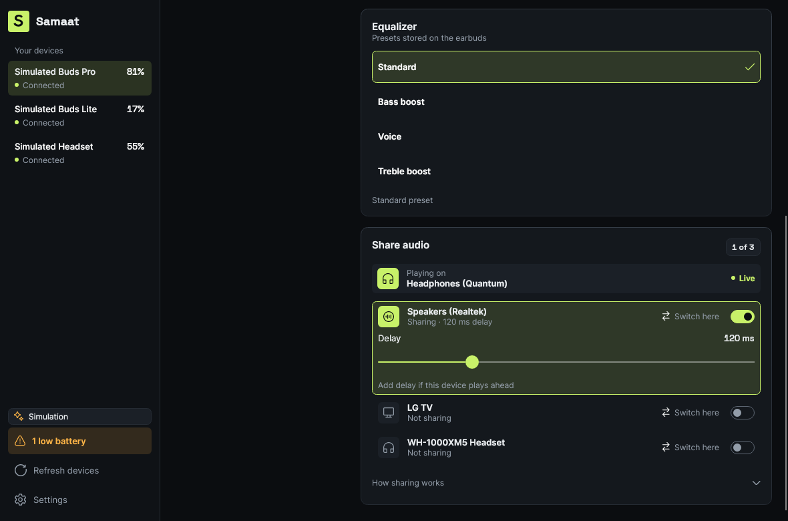
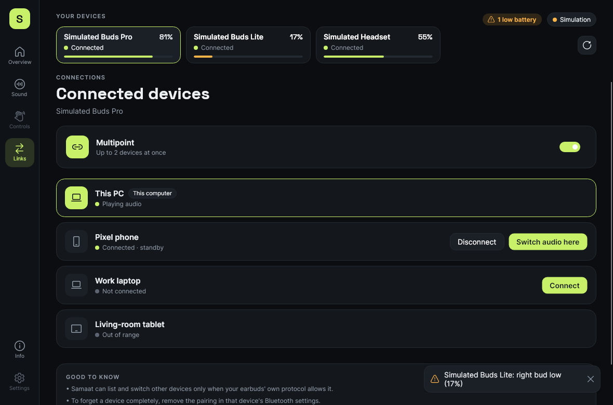

<p align="center"></p>

<h1 align="center">Samaat</h1>

<p align="center">
  <b>One app for Bluetooth earbuds from any brand.</b><br />
  Battery for each bud, noise control, EQ, connections and shared audio, on Windows, plus an Android app to move your earbuds between phone and computer.
</p>

<p align="center">
  <a href="https://github.com/MuhammadAbdulMoiz/samaat.io/actions/workflows/ci.yml"></a>
  
  
  
</p>

<p align="center">
  <a href="#quick-start">Quick start</a> &nbsp;·&nbsp;
  <a href="#supported-earbuds">Supported earbuds</a> &nbsp;·&nbsp;
  <a href="#how-its-built">How it's built</a> &nbsp;·&nbsp;
  <a href="#development">Development</a> &nbsp;·&nbsp;
  <a href="docs/STATUS.md">Status</a> &nbsp;·&nbsp;
  <a href="CONTRIBUTING.md">Contributing</a>
</p>

<picture>
  <source media="(prefers-color-scheme: dark)" srcset="docs/images/buds-pro.png" />
  <source media="(prefers-color-scheme: light)" srcset="docs/images/buds-pro-light.png" />
  
</picture>

Every earbud brand ships its own app, and most only run on a phone. Samaat works out which earbuds are connected and what they can actually do, then shows only the controls that work. Anything it can't do is greyed out with the reason, never just missing.

## What it does

<table>
  <tr>
    <td width="50%" valign="top">
      <b>Battery for each piece</b><br />
      <sub>Left bud, right bud and case, read from the earbuds' own protocol. When a model only reports one number, you get the Windows level, labelled as such.</sub>
    </td>
    <td width="50%" valign="top">
      <b>Noise control and EQ</b><br />
      <sub>Noise cancelling, transparency and the earbuds' EQ presets, on models whose protocol Samaat speaks. Every change is confirmed by reading it back.</sub>
    </td>
  </tr>
  <tr>
    <td width="50%" valign="top">
      <b>Connect and disconnect</b><br />
      <sub>Connect or disconnect your earbuds from the app or the tray, the same way Windows Settings does.</sub>
    </td>
    <td width="50%" valign="top">
      <b>Share audio and Switch here</b><br />
      <sub>Play what Windows is playing on up to three more outputs at once, each with its own delay, or move all audio to another output in one click.</sub>
    </td>
  </tr>
  <tr>
    <td width="50%" valign="top">
      <b>Move to your phone and back</b><br />
      <sub>With Samaat on your Android phone, move the earbuds between the phone and the computer from either one, even earbuds that connect to one device at a time. If the other side can't connect them, they go back where they were.</sub>
    </td>
    <td width="50%" valign="top">
      <b>Paired by a code</b><br />
      <sub>Pair the phone and the computer once by comparing a 6-digit code. They talk over your Wi-Fi with an encrypted link: no account, no server.</sub>
    </td>
  </tr>
  <tr>
    <td width="50%" valign="top">
      <b>Works with unknown earbuds</b><br />
      <sub>Earbuds are matched by the protocol they speak (Google Fast Pair, Jieli RCSP), not by name. Unknown models get a neutral look you can swap for any known model's photo.</sub>
    </td>
    <td width="50%" valign="top">
      <b>Stays out of the way</b><br />
      <sub>Tray icon with battery levels, low-battery notifications, start with Windows, three layouts (Studio, Focus, Glance), dark and light themes, and reduced motion.</sub>
    </td>
  </tr>
</table>

<p>
  
  
</p>

## Quick start

You need the [.NET 10 SDK](https://dotnet.microsoft.com/download). Check it with `dotnet --version`.

```bash
git clone https://github.com/MuhammadAbdulMoiz/samaat.io.git
cd samaat.io

# Windows, with real Bluetooth
dotnet run --project src/Samaat.App -f net10.0-windows10.0.19041.0

# Any OS (Linux, macOS, Windows), with three simulated pairs of earbuds
dotnet run --project src/Samaat.App -f net10.0
```

| Option | What it does |
|---|---|
| `--simulate` | Add the simulated earbuds next to the real ones (Windows) |
| `--all-devices` | List every paired Bluetooth device, not only audio devices |
| `--minimized` | Start in the tray |

To check what Samaat detects on real hardware without the UI, run the console tool:

```bash
dotnet run --project src/Samaat.Cli -f net10.0-windows10.0.19041.0 -- --watch
```

The phone app lives in its own repo, **[samaat-mobile](https://github.com/MuhammadAbdulMoiz/samaat-mobile)**. It runs on Android, or in a window on your laptop, and pairs with this app ([try it](docs/TRY-IT.md)).

## Supported earbuds

| Earbuds | How Samaat talks to them | What works | Hardware notes |
|---|---|---|---|
| **Audionic ParadoX-E** | Jieli RCSP over BLE | Battery per bud, noise control, EQ presets | [2026-11-03](docs/hardware-tests/2026-11-03-audionic-paradox-e.md) |
| **realme Buds T200 Lite** | Google Fast Pair message stream | Battery per bud (case when it reports one), firmware version | [2026-11-03](docs/hardware-tests/2026-11-03-realme-buds-t200-lite.md) |
| **Bose QC Headphones** | Bose BMAP over RFCOMM | Current noise mode (read only), Windows battery | [2026-11-05](docs/hardware-tests/2026-11-05-bose-qc-headphones.md) |
| **Zero Lifestyle Quantum Zbuds** | Windows only (no vendor protocol found) | Overall battery, connect, share audio | [2026-11-02](docs/hardware-tests/2026-11-02-quantum.md) |
| **Microsoft Modern Wireless Headset** | Windows only | Overall battery, connect, share audio | – |
| **Any Fast Pair earbuds** | Google Fast Pair message stream | Battery, when the earbuds report it | – |
| **Any Jieli earbuds** | Jieli RCSP over BLE | What the earbuds list when asked | – |
| **Anything else paired** | Windows | Overall battery, connect, share audio | – |

Protocol notes are in [`docs/protocols`](docs/protocols). Adding a model is a JSON file in [`devices/`](devices/README.md). No model is marked `verified` in the catalog yet: that needs the full hardware checklist in [CONTRIBUTING.md](CONTRIBUTING.md), and until then the app says "recognised, not yet verified on hardware".

## How it's built

Samaat solves "many vendors, one UI" in three moves:

1. **Drivers turn bytes into features.** Each vendor protocol is a codec plus an `IEarbudDriver` that returns feature modules (battery, noise control, EQ, multipoint). The UI renders whatever features a device has, so a new vendor needs no UI changes.
2. **Every feature says why.** A capability is *what the earbuds support × what Samaat supports × whether it's available right now × whether it's been verified on hardware*, so every disabled control can explain itself.
3. **Every write is confirmed.** A change is applied, confirmed by the device, and rolled back if it isn't. After 3 s it times out, and the command is cancelled so it can't block the next one.

```
Samaat.App · Samaat.Cli               composition roots: the desktop app and a hardware check tool
  ├─ Samaat.UI                        design system shared with the phone: tokens, metrics, icons, artwork
  ├─ Samaat.Drivers                   the one list of shipped drivers
  │    └─ Samaat.Protocols.*          Jieli RCSP · Google Fast Pair · Bose BMAP · BLE Battery Service
  ├─ Samaat.Handoff                   phone link: pairing, encrypted sessions, moving earbuds with rollback
  ├─ Samaat.Simulator                 simulated earbuds for UI work and tests
  └─ Samaat.Platform.Windows          WinRT Bluetooth, WASAPI audio sharing, toasts, DPAPI
       Samaat.Core                    features, capabilities, commands, driver contracts, device catalog
         Samaat.Transport             GATT and RFCOMM abstractions
```

Dependencies only point down, and a test reads every project file to keep it that way. The full picture, including how a device becomes a dashboard and how a change reaches the earbuds, is in **[ARCHITECTURE.md](docs/ARCHITECTURE.md)**.

Module pages: [battery](docs/modules/battery.md), [noise control](docs/modules/noise-control.md), [connections](docs/modules/connections.md), [audio sharing](docs/modules/audio-share.md), [phone handoff](docs/modules/phone-handoff.md), [settings](docs/modules/settings.md), [tray](docs/modules/tray.md). UI design notes: [design/ui-audit.md](docs/design/ui-audit.md).

## Development

```bash
dotnet build Samaat.slnx    # warnings are errors
dotnet test Samaat.slnx     # over 950 tests, about a minute
```

We work test-first: write a failing test, make it pass, then refactor ([STATUS.md §4](docs/STATUS.md#4-working-on-samaat-tdd)). CI runs the same two commands on Ubuntu and Windows for every pull request.

| Test project | Covers |
|---|---|
| `Samaat.Core.Tests` | Capability model, battery rules, commands, device catalog and registry, settings, and the architecture rules |
| `Samaat.Protocols.Tests` | Each codec against recorded byte traces, each driver, and every shipped `devices/*.json` model |
| `Samaat.Handoff.Tests` | Pairing, encryption, the wire protocol, and moving earbuds with rollback |
| `Samaat.App.Tests` | View models, plus headless UI tests that render every page in both themes and check hit targets, accessible names, WCAG AA contrast, and that views use design tokens only |

To save the rendered screenshots for review, set `SAMAAT_SCREENSHOTS` to a folder before `dotnet test`. The images in [`docs/images`](docs/images) come from there.

Where things go:

| You're adding | Put it in |
|---|---|
| A new earbud model | `devices/<vendor>/<model>.json` ([format](devices/README.md)) |
| A new vendor protocol | `src/Samaat.Protocols.<Vendor>`, registered in `Samaat.Drivers` ([steps](docs/ARCHITECTURE.md#adding-a-vendor)) |
| A new capability | A feature interface in `Samaat.Core`, then the simulator, then the UI |
| A colour, size or radius | A token in `Samaat.UI/Styles/Tokens.axaml` or `Metrics.axaml`, never a literal in a view |

## Contributing

Bug reports with the Diagnostics tab's **Copy report** are the most useful thing you can send. To add earbuds or a protocol, read [CONTRIBUTING.md](CONTRIBUTING.md): protocols are learned from your own captures, and a model is only marked verified with hardware evidence.

## Privacy

Samaat needs no account and no server. The phone link stays on your local network over an encrypted connection, and paired phones are stored encrypted on your computer (DPAPI on Windows).
