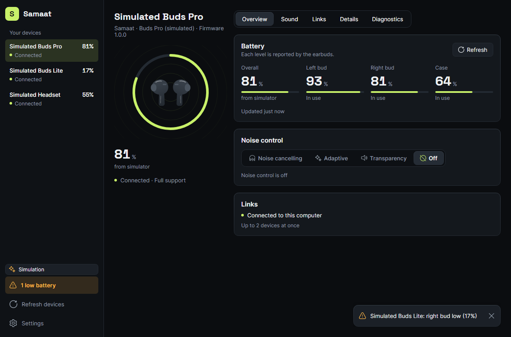
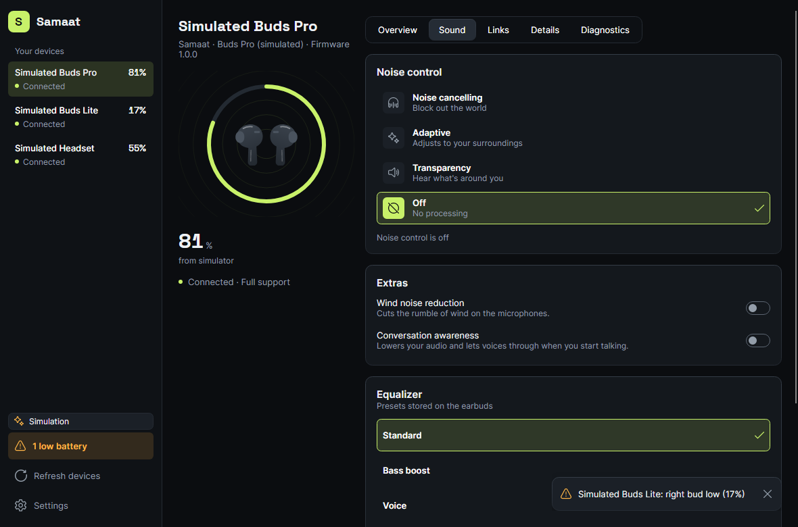
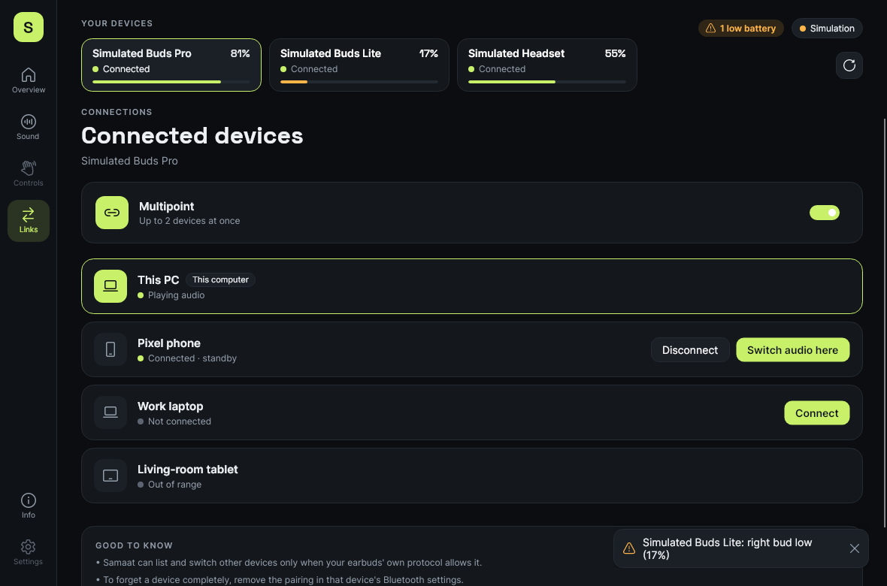
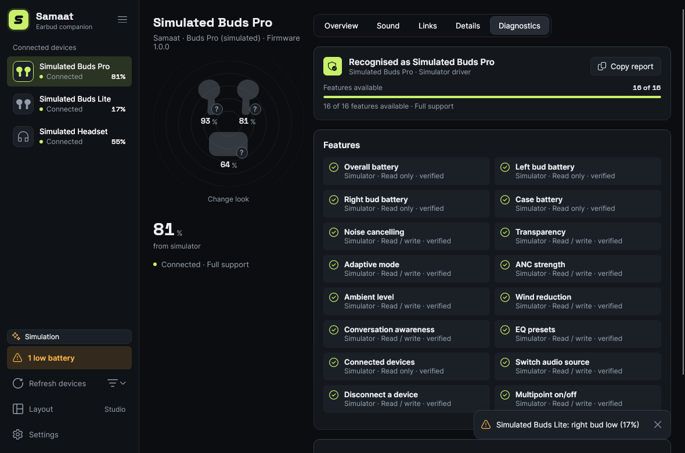
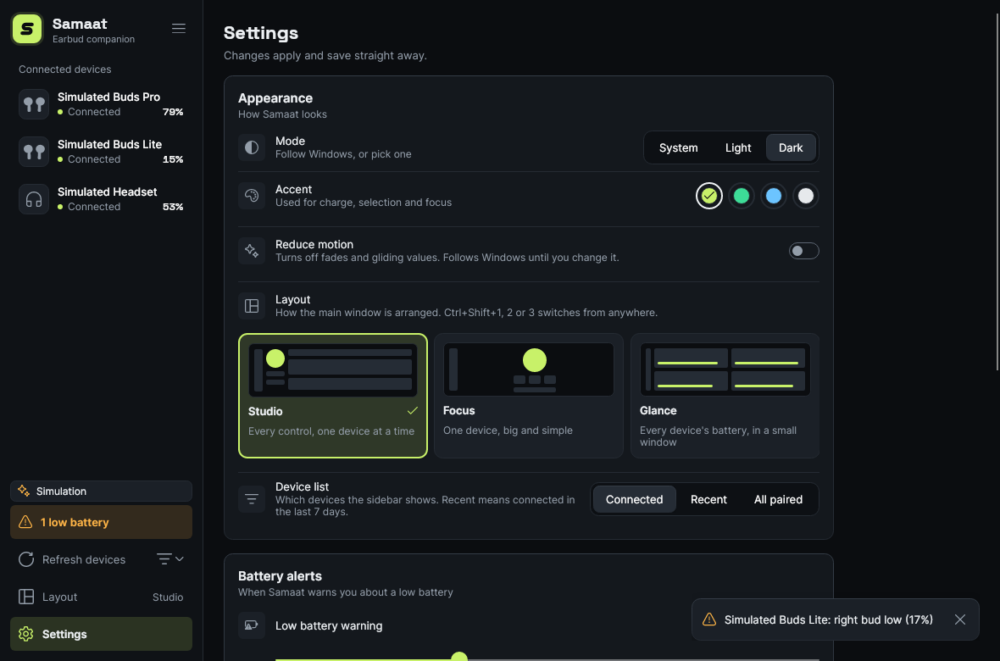

# Samaat: status, remaining work and getting started

Last updated: 2026-11-06

## TL;DR

- **Done:** project foundation, the capability engine, the first three modules (battery, noise control, multipoint), the driver registry and device catalog, and **Settings, Bluetooth details, the device profile DB, and the tray with system notifications**. Real Bluetooth on Windows has now **run on hardware** (Zero Lifestyle Quantum Zbuds, [test notes](hardware-tests/2026-11-02-quantum.md)): discovery, the Windows battery level, device details and profile matching work. The **first vendor adapter** (Jieli RCSP over BLE) reads per-bud battery and switches noise control (off, noise cancelling, transparency) and EQ presets on the Audionic ParadoX-E ([test notes](hardware-tests/2026-11-03-audionic-paradox-e.md), [protocol](protocols/jieli-rcsp.md)). Fast Pair reads battery and firmware on the realme Buds T200 Lite, and the **Bose QC Headphones** show the Windows battery and their current noise mode (Quiet or Aware), read-only over BMAP ([test notes](hardware-tests/2026-11-05-bose-qc-headphones.md), [protocol](protocols/bose-bmap.md)). Everything else runs against **simulated devices**.
- **New: move earbuds between this computer and a phone, and the Android app** ([details](modules/phone-handoff.md)). Works with single-connection earbuds: the computer checks the phone, disconnects here, the phone connects, and the computer reconnects if the phone doesn't. Pairing by a 6-digit code, encrypted link over the local network. The Android app (Avalonia, sharing Core and the drivers) has battery, noise control, EQ and the move card. **Not run on a phone yet**; CI builds the APK. One switch, `AppOptions.PhoneHandoff`, turns it on or off: on by default, off in the Microsoft Store (MSIX) build.
- **Not done:** multipoint and custom EQ bands on real earbuds, switching noise modes on the Bose, and any write on real devices other than the ParadoX-E. The Quantum Zbuds have no usable vendor protocol.
- **Tests:** 1,085 automated tests here (Core 320, Protocols 215, App 408, Handoff 117, and Platform.Windows 25, which runs on Windows only), plus 18 phone tests in [samaat-mobile](https://github.com/MuhammadAbdulMoiz/samaat-mobile). CI runs them on Linux and Windows and reports line coverage; samaat-mobile's CI builds the Android APK. The UI tests render dark and light screenshots of every page, on a fixed clock so the images only change when the UI does.

| Overview | Sound | Links |
|---|---|---|
|  |  |  |

| Diagnostics | Settings |
|---|---|
|  |  |

---

## 1. What's done

### Foundation
- .NET 10 solution, central package versions, warnings as errors, CI on Ubuntu and Windows (`.github/workflows/ci.yml`).
- **Capability model**: every feature is described as *device support × Samaat support × available now × verified*, so every disabled control can say why. "Unknown" is never shown as "unsupported". (`Samaat.Core/Capabilities`)
- **Device registry**: merges devices from every source (Windows Bluetooth, simulator). (`Samaat.Core/Devices`)
- **Command layer**: every write returns a `CommandResult` (confirmed / rejected / unsupported / timed out / failed). `CommandRunner` adds a 3 s timeout, and `LatestValueSender` coalesces slider drags. (`Samaat.Core/Commands`)
- **Simulator**: three devices with different shapes (Buds Pro has everything, Buds Lite is basic, the Headset is minimal), realistic command latency, and injectable failures. (`Samaat.Simulator`)
- **UI**: Avalonia desktop app with three layouts (Studio, the default; Focus; Glance) switched from the sidebar, Settings or Ctrl+Shift+1–3, a labelled sidebar (connected devices by default, with a Recent / All paired filter beside Refresh; collapses to an icon rail below 900 px), a device rail plus a tab well (Overview, Sound, Links, Details, Diagnostics), accent presets (Lime, Emerald, Ice, Mono), reduced motion, dark and light themes, and a design system (`docs/design/ui-audit.md`). The Controls (touch gestures) section is roadmap only and not in the navigation.

### Module 1: Battery ([details](modules/battery.md))
Left / right / case or a single level, charging state, where each bud is, data age and staleness, low and critical alerts with hysteresis. Sources: simulator, the BLE Battery Service, and the level Windows itself reports.

### Module 2: Noise control ([details](modules/noise-control.md))
Noise cancelling, adaptive, transparency and off. ANC strength and ambient level sliders, wind reduction, conversation awareness. The UI layout follows from what the device reports. Changes are optimistic, confirmed by the device, and rolled back on failure.

### Module 3: Multipoint and connected devices ([details](modules/connections.md))
Host list with states, switch / connect / disconnect, a multipoint switch, and a connection limit. This computer can be connected and disconnected from Samaat (Links page, overview, tray). Without device support, it honestly shows only this computer and explains why.

### Architecture pass (OpenMouse patterns, [details](ARCHITECTURE.md))
- **Driver registry and device catalog**: devices resolve to *generic*, *recognised (adapter not built yet)* or *driver*. `devices/**/*.json` entries carry a `verified` flag. Adding a model is a data change, and adding a vendor needs no UI changes.
- **RFCOMM transport**: `IRfcommChannel` plus a WinRT implementation, ready for the first driver (unverified on hardware).
- **Windows detection signals**: class of device and SDP service UUIDs, shown in the Diagnostics technical details and in the CLI.
- **Feature-organised app**: `Shell/`, `Features/{Overview,Sound,Connections,Info,Details,Settings}`, `Shared/`, `Styles/` split by area.
- **Diagnostics tab** (the Info page): a summary line ("n of 15 features available"), how the device was recognised (driver catalog or device profile), one capability list (available features with source and verification; unavailable ones grouped by module and collapsed), collapsed Technical details and Event log, and **Copy report** for hardware bug reports.
- `CONTRIBUTING.md` sets the hardware-evidence rules for marking a model verified.

### UI polish ([details](design/ui-audit.md#round-3-polish-2026-11-02))
Redrawn earbud artwork and charging badges, a compact stat strip, toasts that hide themselves plus an alert counter, animated rings and page cross-fades, layouts that work down to 640 px, and automated WCAG contrast tests.

### Settings ([details](modules/settings.md))
Theme, accent preset, reduce motion, battery alert thresholds, case alerts, system notifications, keep running in the tray, start with Windows. Saved to `%APPDATA%/Samaat/settings.json`; bad files fall back to defaults.

### Bluetooth details and device profiles ([details](modules/info.md))
The **Details** page shows vendor and product ID, address, advertised services, support tier and battery source, and the `devices/<vendor>/<model>.json` profile DB names known models. First profile: Zero Lifestyle Quantum Zbuds. Two device databases exist for now: master's `DeviceCatalog` (driver resolution) and our `DeviceProfileDb` (display name and details). They read the same `devices/` folder and should be unified later.

### Drivers by protocol ([details](../devices/README.md#generic-entries-generic))
`devices/generic/` gives unknown earbuds a driver by protocol: any device advertising the Fast Pair Message Stream gets `fast-pair`, and any with Jieli's vendor ID `0x05D6` gets `jieli-rcsp`. A model entry wins for identity, so the four models keep their names and photos; a model with no driver of its own (Quantum, Microsoft headset) still gets a matching protocol driver (Jieli by vendor ID, Fast Pair by the stream), which probes and gives nothing if the buds do not speak it. `DeviceProfileDb` skips generic files on purpose. Drivers expose only what the buds answer for: Jieli noise control and EQ only when the buds list them when read back, and nothing without BLE `AE00`. Otherwise the device falls back to the Windows battery. Checked with `samaat-cli` on 2026-11-03: the ParadoX-E, T200 Lite, Quantum and Microsoft headset each still resolve to their own entry, and the Quantum advertises `fe010000-…`, not the Fast Pair stream. No unknown device has been tried on hardware yet.

### Share audio and Switch here ([details](modules/audio-share.md))
On the Sound page, the default output can be played on up to 3 other outputs at once, each with its own delay. Switch here makes any output the Windows default. Windows only (WASAPI loopback through NAudio; `IPolicyConfig` for switching). Checked on hardware with the Quantum and the laptop speakers.

### Move earbuds to and from a phone, and the Android app ([details](modules/phone-handoff.md))
- **Any earbuds:** the computer coordinates each move (check the phone → disconnect here → phone connects → reconnect here if it doesn't), so single-connection earbuds work. Moves start from either side; progress shows on both.
- **Pairing:** ECDH P-256 with a commitment and a 6-digit comparison code; sessions are AES-256-GCM over TCP. The computer is found by a UDP beacon sent only while pairing is open; paired phones dial the address they stored. Secrets are DPAPI-encrypted on Windows (owner-only file elsewhere). The computer listens only while a phone is paired or pairing is open, and serves at most 4 handshakes at once.
- **Desktop:** Settings → Phone (pair, paired phones, forget) and the Links page's **Your phone** card.
- **Android app:** in its own repo, [samaat-mobile](https://github.com/MuhammadAbdulMoiz/samaat-mobile) (`Samaat.Mobile` shared UI, `Samaat.Platform.Android`, `Samaat.Android`, and a phone preview for laptops), building this repo's shared projects from a submodule. Connecting on Android tries the hidden profile methods, then asks the user for one tap. Not run on a phone yet.

### Tray and notifications ([details](modules/tray.md))
Tray icon with battery tooltip and menu, close to tray, `--minimized`, and Windows notifications for low battery (verified on one PC only).

### Tools
- `samaat-cli`: prints what Samaat detects for each device (including identified profile, IDs and services), with `--watch` for live changes. Used for hardware checks.

---

## 2. What's remaining

### Blocking: needs a decision from you

*Also settled 2026-11-06 ([record](decisions/2026-11-06-settled-decisions.md)): the `.claude/` keep-list, and the battery tile label ("Overall" is now "Lowest bud").*
1. **Which earbuds to target first** (PLAN §13 Q1). Every real ANC, multipoint and L/R/case battery feature depends on it. The Quantum Zbuds were tested and have no usable vendor protocol; pick a model with a companion app or a BLE side.
2. **Windows-first or Android-first** (§13 Q2). The core and the UI are portable; the platform layer isn't. An Android app now exists (for moving earbuds between phone and computer), so this is about which platform gets hardware attention first.
3. ~~**License / open source** (§13 Q4)~~ **Settled 2026-11-06:** GPL-3.0-or-later for both repos ([decision](decisions/2026-11-06-settled-decisions.md)).

### Next engineering steps
| # | Item | Notes |
|---|---|---|
| 1 | **Run on real Windows hardware** | Done once with the Quantum Zbuds. Re-check Samaat's battery refresh after a reconnect (`--watch` during a case-lid test), the Start with Windows toggle, and a notification on a clean Windows profile. |
| 2 | **RFCOMM transport** | `IRfcommChannel` plus a WinRT implementation (open a vendor service UUID on a paired device). |
| 3 | **First vendor adapter** | **Battery done** for the Audionic ParadoX-E (`Samaat.Protocols.Jieli`, `devices/audionic/paradox-e.json`): L/R (case when reported) from the AdvInfo push, unverified on firmware beyond one unit. **Noise control and EQ presets done** (SetSysInfo, verified by ear on one unit; commands in [docs/protocols/jieli-rcsp.md](protocols/jieli-rcsp.md)). Next: the case byte, custom EQ bands. |
| 3b | **Fast Pair Message Stream** | **Battery and firmware done** for the realme Buds T200 Lite (`Samaat.Protocols.FastPair`, `devices/realme/buds-t200-lite.json`): L/R (case when reported) and firmware over RFCOMM `df21fe2c-...`, read-only, verified on one unit ([test notes](hardware-tests/2026-11-03-realme-buds-t200-lite.md)). Next: the case byte, ANC. |
| 3c | **Bose BMAP** | **Current noise mode done, read-only**, for the Bose QC Headphones (`Samaat.Protocols.Bose`, `devices/bose/qc-headphones.json`): Quiet or Aware over raw RFCOMM channel 8/9; battery from Windows HFP; `verified: false` ([test notes](hardware-tests/2026-11-05-bose-qc-headphones.md)). Next: switching modes. |
| 4 | **First catalog entries** | Matching and loading are done; add real entries from hardware reports (Info → Copy report). |
| 5 | **Reconnect handling** | Re-handshake after the earbuds drop and return. |
| 5b | **Phone handoff on hardware** | Install the CI APK on an Android phone, pair, and run the checklist in [the plan](plans/2026-11-04-phone-handoff.md#hardware-check-not-doable-in-ci). Record which connect strategy each phone needs. |
| 6 | **Unify the device databases** | Fold `DeviceProfileDb` into `DeviceCatalog` so one `devices/**/*.json` schema and loader serves driver resolution and the Details page. |

### Later modules (on the nav rail as "soon")
- **Controls**: touch gesture remapping (vendor protocol only).
- **Equalizer**: device EQ and Samaat EQ, kept separate.
- **Info**: diagnostics are done; firmware and codec details come with drivers.
- Find my earbuds, wear detection, Android port, Linux (BlueZ).

### Known limitations today
- Windows gives a single combined battery level only. L/R/case needs a vendor adapter.
- A disconnected device still shows the last battery level Windows stored (Windows Settings hides it).
- Connect / Disconnect for this computer (Links page, overview, tray) uses the same Bluetooth audio KS property as Windows Settings. Built and checked against the real filters read-only; **not yet run on hardware** (undocumented API, fallback is `ms-settings:bluetooth`).
- A device that starts reporting battery after launch appears on the next **Refresh**.
- System notifications are verified on one PC only.
- Moving earbuds to a phone needs both on the same network, and Android usually needs one tap from the user to connect. Not run on a phone yet.

---

## 3. How to start the app

### Prerequisites
- **.NET 10 SDK**: <https://dotnet.microsoft.com/download> (on Ubuntu 24.04: `sudo apt install dotnet-sdk-10.0`)
- Windows 10 2004+ or Windows 11 for real Bluetooth. Any OS works for the simulator.

### Get the code
```bash
git clone https://github.com/MuhammadAbdulMoiz/samaat.io.git
cd samaat.io
```

### Run the desktop app
```bash
# Any OS: simulated devices
dotnet run --project src/Samaat.App -f net10.0

# Windows: your real paired earbuds
dotnet run --project src/Samaat.App -f net10.0-windows10.0.19041.0

# Windows: real devices plus the simulated ones
dotnet run --project src/Samaat.App -f net10.0-windows10.0.19041.0 -- --simulate
```
Options: `--simulate` adds simulated devices; `--all-devices` also lists paired non-audio devices; `--minimized` starts in the tray; `--test-notification` shows one system notification.

In the simulator, try:
- **Overview**: batteries drain and recharge live, and the right bud of *Buds Lite* triggers a low-battery alert.
- **Sound** on *Buds Pro*: switch modes, then drag the strength slider. On *Buds Lite* there's a single switch. On *Headset* the card explains why it's unavailable.
- **Links** on *Buds Pro*: switch audio to the phone, connect the laptop (watch the phone drop to standby), turn multipoint off.

### Run the CLI
```bash
dotnet run --project src/Samaat.Cli -f net10.0 -- --simulate --watch                    # any OS
dotnet run --project src/Samaat.Cli -f net10.0-windows10.0.19041.0 -- --watch           # Windows, real devices
```

### Build a standalone Windows executable
```bash
dotnet publish src/Samaat.App -f net10.0-windows10.0.19041.0 -c Release -r win-x64 --self-contained
# output: src/Samaat.App/bin/Release/net10.0-windows10.0.19041.0/win-x64/publish/Samaat.exe
```

---

## 4. Working on Samaat (TDD)

We work test-first: **red → green → refactor**.

1. **Red:** write the test for the behaviour in the matching test project and watch it fail (a compile error counts).
2. **Green:** write the smallest code that passes.
3. **Refactor** with the tests green. Run everything before committing.

```bash
dotnet test Samaat.slnx                                   # all tests
dotnet test tests/Samaat.Core.Tests                       # one project
dotnet test Samaat.slnx --filter "FullyQualifiedName~NoiseControl"
SAMAAT_SCREENSHOTS=artifacts/screenshots dotnet test tests/Samaat.App.Tests   # also save UI screenshots
```

| Test project | What goes there |
|---|---|
| `Samaat.Core.Tests` | Capability rules, models, commands, simulator behaviour. Pure and fast; uses `FakeTimeProvider` instead of real time. |
| `Samaat.Protocols.Tests` | Byte parsing and protocol features against fake transports, replaying bytes recorded from real devices (`JieliFakes.cs`, `FastPairFakes.cs`, `BoseFrames` in `BoseBmapTests.cs`). |
| `Samaat.Platform.Windows.Tests` | The Windows platform's pure logic: selectors, signal mapping, KS-property requests, toast text. Windows only. |
| `Samaat.App.Tests` | View models (with a synchronous dispatcher) and headless UI tests that render the real window. |
| `Samaat.Handoff.Tests` | The phone link: crypto, framing, pairing, sessions, the move coordinator, and loopback end-to-end runs. |

Conventions:
- New device capabilities go in as a feature interface in Core first (`IXxxFeature`), then the simulator, then the UI. That keeps a vendor adapter "just another implementation".
- Every write is a `CommandResult`, so the UI must handle refused and timed-out commands.
- Never hide an unsupported feature. Give it a reason.

## Repository map

```
src/
  Samaat.Core/                 capabilities, battery, noise control, connections, commands, device registry
  Samaat.Transport/            byte-level transport abstractions (GATT now; RFCOMM next)
  Samaat.Protocols.Standard/   BLE Battery Service
  Samaat.Platform.Windows/     WinRT discovery, Windows-reported battery, GATT client
  Samaat.Simulator/            simulated devices for development and tests
  Samaat.Handoff/              phone link: pairing, encrypted sessions, moving earbuds with rollback
  Samaat.UI/                   the shared design system: tokens, icons, fonts, battery ring, sound waves
  Samaat.App/                  Avalonia desktop app (Shell/, Features/, Shared/, Styles/)
  Samaat.Cli/                  hardware check tool
tests/                         Core, Protocols, App, Handoff and Platform.Windows test projects (the phone app and its tests: samaat-mobile repo)
docs/                          PLAN, STATUS (this file), design audit, per-module docs, screenshots
```
