# UI audit and redesign: battery dashboard v0.1

## Design critique of v0.1

Screens reviewed: `docs/images/v0.1/battery-*.png` (before this redesign). Redesigned screens: `docs/images/*.png`.

### Overall impression
It works and is honest about capabilities, but it looks like a default admin template: grey cards, stock Fluent buttons, a blue selection colour that clashes with the teal accent, and no product identity. Nothing on screen says "earbuds". The battery numbers, which are the whole point of the screen, get the same weight as the surrounding chrome.

### Usability

| Finding | Severity | Recommendation |
|---|---|---|
| The alert banner for *Buds Lite* stays at the top while you look at *Buds Pro*, so it reads as if it belongs to the current device | 🔴 | Show the current device's alert inside its hero. Show other devices' alerts as dismissible toasts that name the device |
| On a single-level headset, three greyed-out tiles take more space than the one real reading | 🟡 | Hide unsupported components behind one compact "not reported" row of chips. Keep them visible (honesty) but small |
| The capability list repeats the battery tiles word for word | 🟡 | Show capabilities as compact chips with an icon and state. Group unavailable ones together |
| "Refresh battery" is a prominent grey button, although most sources push updates on their own | 🟢 | Make it an icon button with a tooltip |
| Nothing hints at the rest of the product (sound, gestures, multipoint) | 🟡 | Add a navigation rail with upcoming sections disabled and marked "Soon" |
| The device list shows only a percentage, with no connection state at a glance | 🟢 | Device chips with a connection dot and a mini battery bar |

### Visual hierarchy
- **What draws the eye first:** the yellow alert banner, then the blue list selection. ❌ It should be the earbuds and their charge.
- **Reading flow:** title → grey button → three equal tiles → a list that repeats them. No focal point.
- **Emphasis:** the support tier and battery source are tiny grey text, though they explain *why* things are greyed out.

### Consistency

| Element | Issue | Recommendation |
|---|---|---|
| Colour | Fluent's blue selection versus the teal brand accent | One accent token applied everywhere: selection, focus, charge |
| Buttons | Stock grey Fluent buttons | Custom subtle and icon button styles |
| Type | One family and weight everywhere, numbers not tabular | A display face for numbers and headings, Inter for body text, tabular figures |
| Surfaces | Pure white cards on light grey, no borders, no depth | Layered surfaces with hairline borders, dark-first |

### Accessibility
- **Contrast:** greyed tiles use 50 % opacity on muted text, about 2:1. ❌ Use explicit "disabled" colour tokens that stay at least 4.5:1 for the reason text.
- **Low battery shown by colour alone:** the percentage is always shown, and the redesign adds an icon and label for low and critical.
- **Targets:** buttons are 32 px or more. Fine.

### What works
- Every unavailable item explains why, and "unknown" is never shown as "unsupported".
- The "updated X ago" and stale states.

## Redesign direction: "Listening room"

References used:
- **Vendor companion apps:** Galaxy Wearable, Sony Headphones Connect and the Nothing X app all centre the *device* and put each bud's battery under its own bud. We take that layout pattern, not their visuals or branding.
- **Dribbble earbud-controller concepts:** dark dashboards with a hero device card and glanceable battery rings.
- **Avalonia theme libraries:** [SukiUI](https://github.com/kikipoulet/SukiUI) and [Semi.Avalonia](https://github.com/irihitech/Semi.Avalonia), for surface layering, hairline borders, and a nav rail plus content shell. We implement our own tokens instead of adopting either: SukiUI's glass look is itself generic, and Semi.Avalonia has moved to Avalonia 12.
- **[Fluent UI System Icons](https://github.com/microsoft/fluentui-system-icons) (MIT):** the icons, embedded as path geometry.
- **[Space Grotesk](https://github.com/floriankarsten/space-grotesk) (OFL):** a display face for numbers and headings.

Principles:
1. **The device is the hero.** Vector buds and case, each wrapped in a battery ring, sit on a sound-wave motif (Samaat means "hearing").
2. **Dark-first with one signal colour.** Ink surfaces and a "signal lime" accent for charge. Amber means low, coral means critical, and each also gets an icon and a label.
3. **Honest but quiet.** Unsupported components shrink to chips. They don't disappear.
4. **The roadmap is visible.** The nav rail shows Sound, Controls and Connections as "Soon".

## Round 3: polish (2026-11-02)

| Area | Change |
|---|---|
| Hero artwork | Earbuds redrawn with an angled stem, eartip, speaker grille, gradient body and highlights. The case gets a gradient body. A charging badge appears on any ring that's charging. |
| Density | The four stat cards became one compact strip that wraps to 2×2 in narrow windows. |
| Alerts | Toasts hide themselves after 8 s. A top-bar "N low battery" chip keeps the state and jumps to the affected device. |
| Motion | Battery rings and device-card bars glide to new values (0.45 s ease-out), pages cross-fade (0.18 s), and a thin busy bar shows while a command waits for the device. |
| Narrow windows | The hero stacks below about 260 px of text width (`SplitPanel`). Stat and Info columns adapt (`AdaptiveColumns`), the device strip scrolls, and the minimum window width dropped from 860 to 640 px. |
| Accessibility | Automated WCAG AA contrast tests for every text/background token pair in both themes. They caught light-theme amber (4.14:1) and red (4.48:1) on alert pills, both fixed. Screen-reader names added to icon-only buttons and battery gauges. |

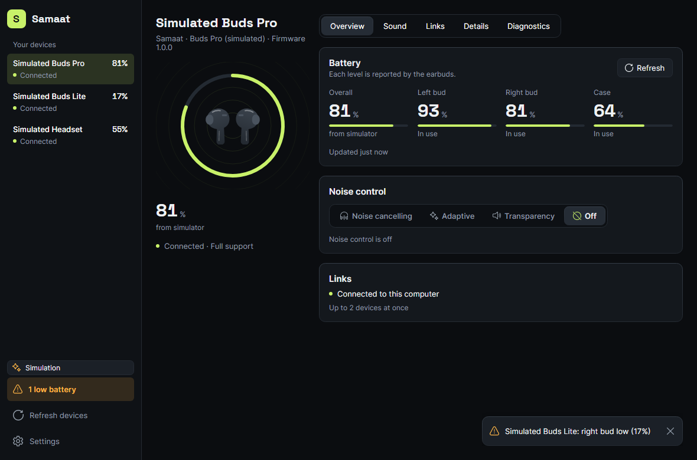 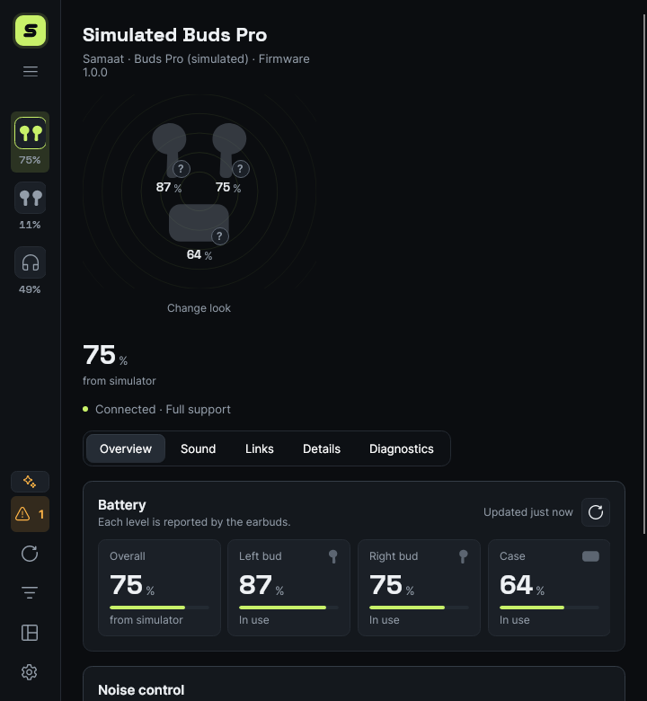

## OpenMouse-style redesign (2026-11-03)

Benchmark: OpenMouse's design notes (ideas only; no code, assets or colours copied, as OpenMouse is AGPL). Plan: `docs/plans/2026-11-03-ui-redesign.md`.

| Area | Change |
|---|---|
| Navigation | A 240 px labelled sidebar (devices, alert counter, refresh, settings) replaces the icon rail and top strip. It collapses to a 68 px rail below 900 px. |
| Device page | A 260 px rail (name, artwork on the canvas inside the level ring, battery figure, status line) beside a workspace with a segmented tab well: Overview, Sound, Links, Details, Diagnostics. The rail stacks above the workspace below 760 px. |
| Content | Numbers first (label, value, unit, meta, tabular figures), "–" for unreported values, sentence case everywhere, flat unnested panels, switch rows. Capability chips live only in Diagnostics. |
| Shape | 4 px grid, 16 px panel padding and gaps, rows 40 px or more, buttons 32 px, switches 36x20, radii 6 / 10 / 14. |
| Theme | Accent presets Lime, Emerald, Ice and Mono, all checked against the WCAG AA tests in both themes. |
| Motion | New "Reduce motion" setting (follows Windows until changed): no page fade and no gliding values. |

## Links page rework (2026-11-04)

Goal: make the Links tab feel as considered as the Share audio card. It should work for earbuds with no multipoint protocol (most real devices, for example Quantum Zbuds) and for the simulator's multipoint Buds Pro. Reviewed with the design-critique, accessibility-review and ux-copy passes, plus stress renders (long names, six hosts, zero hosts, disconnected, busy with an error, no PC-link feature).

| Before | After | Why |
|---|---|---|
| "Disconnect" was a borderless text button floating top right. It read as a label | A `Button.subtle` with the disconnect icon, inside the state row. Connect is `Button.primary` | An action needs an affordance. Connect is the one thing a disconnected user came to do, so it gets the fill. Disconnect is reversible but not the main path, so it stays quiet |
| State, action and explanation sat in one flat block with no hierarchy | One row on the `Surface2` strip, like Share's "Playing on": a laptop tile that lights when connected, then a bold state ("Connected", "Connecting…"), one line of meaning, and the action | You read the state first, then what it means, then what you can do. The tile repeats the state without relying on colour alone |
| A long grey paragraph about other devices sat inside "This computer" | A separate "Devices" panel with an honest empty-state row: "Other devices aren't shown for these earbuds", plus "Manage them on each device" | Keeps "this computer" about this computer. The empty state says what's missing and where to go, in two short lines |
| A "Good to know" card of three grey sentences | A "How links work" disclosure (`ToggleButton.disclosure`), the same pattern as "How sharing works" | The limits are still always stated (PLAN §8) but no longer compete with live state. The "disconnected means no control" fact moved into the not-connected detail line, where it matters |
| Multipoint was its own card, then a "Connected devices" card | One "Devices" panel: a "2 of 2" count chip, the multipoint switch row, a divider, then host rows | One concept, one panel. The count chip mirrors Share's "1 of 3" |
| Host rows had `Button.primary` "Switch audio here" and boxed "Disconnect" on every row | `Border.shareRow` anatomy. The active host gets the accent row. Actions are `Button.ghost` with icons ("Switch here", "Connect", "Disconnect"), like Share | Several bright fills in a list shouted. Quiet actions keep the playing device as the focal point |
| A busy bar pushed the title down by 12 px (negative margins don't shrink a StackPanel slot) | The bar is overlaid on the panel's top edge | No layout jump while a request runs |
| Disabled Connect/Disconnect looked enabled | `Button.subtle:disabled` and `Button.primary:disabled` dim to 0.45, like a disabled switch. The headline reads "Connecting…" and the tooltip says "Wait for the current request to finish" | A disabled control says why |
| Zero hosts showed only a header and a divider | "No other devices yet. Devices you pair these earbuds with appear here." | An empty list needs an empty state |

**Accessibility.** Every button is 32 px or taller. The multipoint switch uses the `ToggleSwitch.share` template's 32 px hit area. Host buttons name their host ("Switch audio to Pixel phone", "Disconnect Pixel phone", "Connect Work laptop"). The locked multipoint switch carries `HelpText` and a tooltip ("These earbuds don't let Samaat change this"). Hidden host actions are explained in text when this computer is disconnected. Long host names trim with an ellipsis and keep the full name in a tooltip. No new colours: every text pair is already covered by the WCAG contrast tests.

**Copy.** Sentence case and verbs first. "Switch here" matches Share. A not-yet-connected host gets "Connect". The busy states are "Connecting…" and "Disconnecting…". The fallback button is "Bluetooth settings", and its row says "Connect or disconnect in Windows Bluetooth settings".

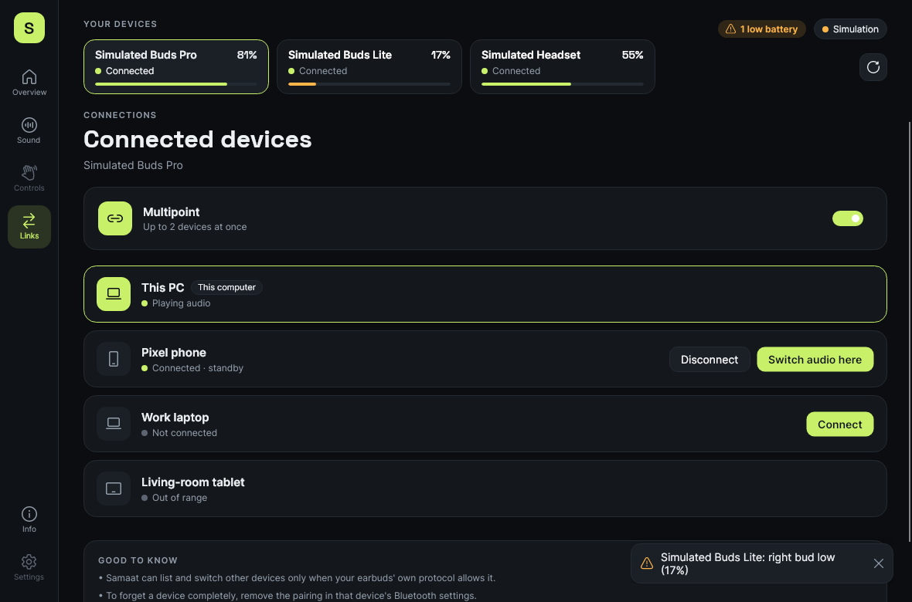 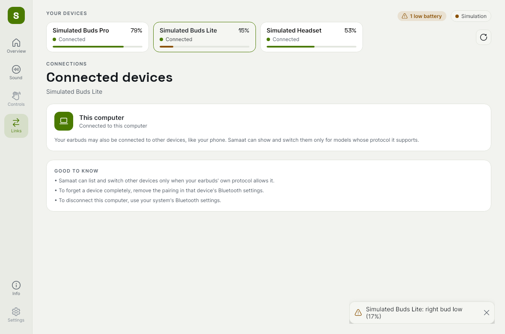

## Overview, Details, Diagnostics, Settings and sidebar (2026-11-04)

Follow-up to the Links rework, using the same row anatomy throughout: a 32 px icon tile, a label over one line of meaning, and the control on the right.

| Before | After | Why |
|---|---|---|
| Sidebar brand: a small S square and the word "Samaat" | The S, drawn larger with round caps, on the accent key inside a soft accent halo. "Earbud companion" under the name, and a burger button that collapses or expands the sidebar | The mark reads as a logo, not a placeholder. The toggle makes the rail a choice, not only something narrow windows do |
| Collapsed rail only below 900 px | Burger toggle in both states ("Collapse sidebar" / "Expand sidebar"). The choice holds until the window crosses 900 px, then the width takes over again | A manual collapse never fights the narrow-window layout |
| Device rows were text only; the rail showed initials | Each row has a 36 px thumbnail: the device's own photo, a pair of bud glyphs, or headphones for a headset. The current device gets an accent edge and accent glyphs. The percentage moved onto the status line, so names get the full width | You recognise a device by its shape faster than by its name, and long names like "realme Buds T200 Lite" no longer cut off early |
| Overview battery: bare numbers in columns, a text Refresh button | One tile per component, with a bud or case glyph and a charge icon. Unreported tiles are outline only. A lone Lowest bud tile stays tile-sized. "Updated …" sits next to an icon refresh button | Components read as objects. A single figure no longer stretches across the panel |
| Overview noise control and links were grey sentences | An icon-tile empty state for noise control. Links is one state row with "Manage ›", which opens the Links tab | Every card says its state, then where to act |
| Details was one ten-row table with "Support" in the middle | A header with an identification tile, then "Device" and "Connection" groups, selectable values, and copy buttons for address and IDs. Support became a shield row with the adapter note | Grouping matches how people look things up, and copying an address is a common need |
| Diagnostics: a header line, then a 16-row single-column list | A recognition header with Copy report and a "features available" meter. Working features show in a two-column grid. Technical details and the event log are separate disclosure panels with icons | Half the scroll length, and the summary is visible at a glance |
| Settings: plain rows, accent as a tab well of words | Icon-tile rows in Appearance, Battery alerts and Background. Accent is four 32 px round swatches with a ring and a check. Thresholds show as chips. A new About panel shows the mark and version | Settings scan by icon, and colour is picked by colour |

**Accessibility.** All new buttons are 32 px (icon buttons, swatches, copy). The burger, swatches and copy buttons have accessible names that match their tooltips. Battery tiles carry each component's accessible text. No new motion. Colours are tokens, except the fixed preset swatches, which have an outline so Mono stays visible on light backgrounds.

 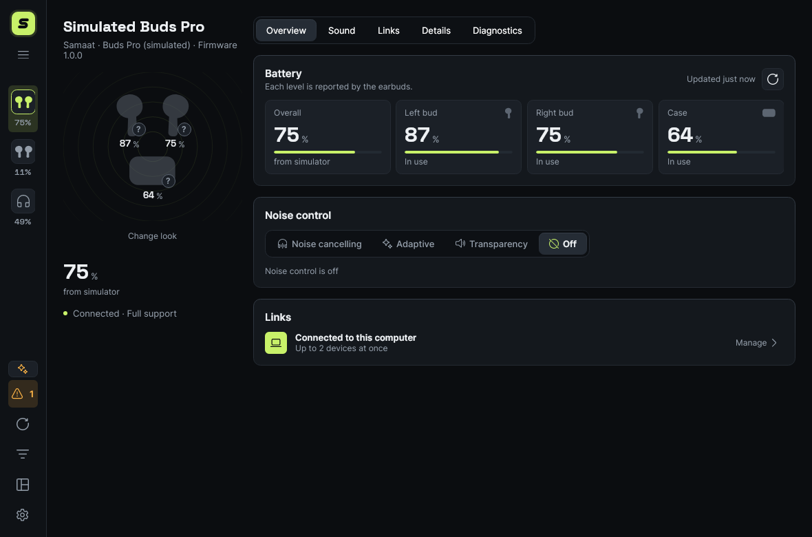 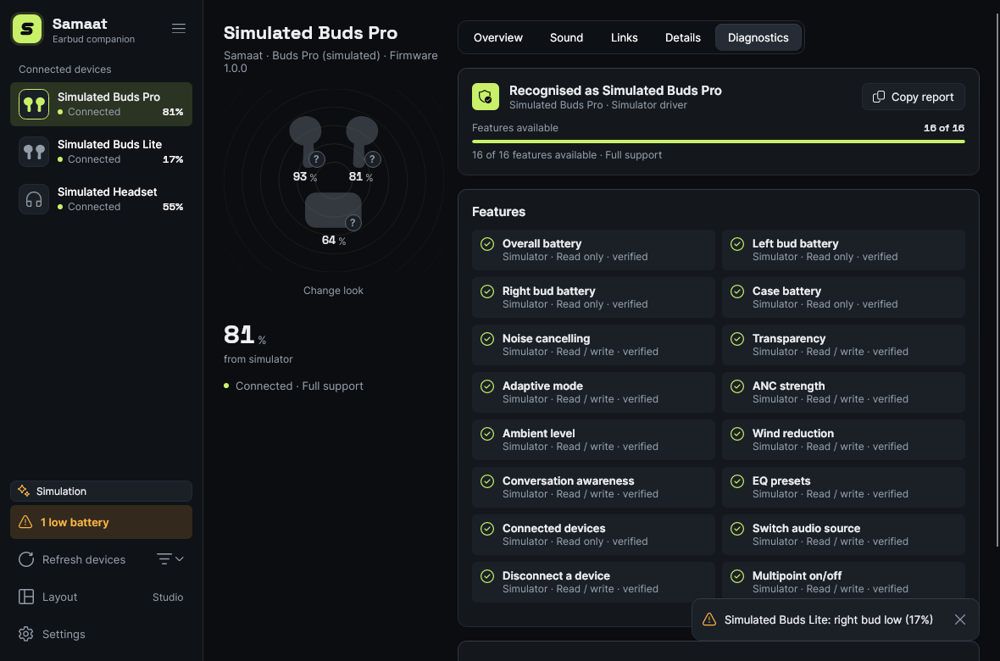 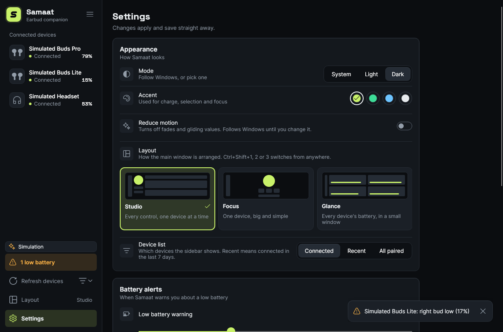

## Dashboard layouts and the device filter (2026-11-04)

Plan: `docs/plans/2026-11-04-dashboard-views.md`. There are three layouts, with Studio (the existing one) as the default. All three share the same view models, tokens and the shared `DeviceStage` and `BatteryFigures` parts. Original designs, no third-party templates.

| Layout | What it is for | What it shows |
|---|---|---|
| **Studio** (default) | Every control, one device at a time | Unchanged: device rail plus the Overview · Sound · Links · Details · Diagnostics tab well |
| **Focus** | One device, big and calm | A centred column with the name and status line, the artwork stage scaled up (it shrinks with the window), the battery tiles, and "Quick controls" (noise mode, Connect or Disconnect, Refresh). Sound, Links, Details and Diagnostics open in place under "More", with a short header and Back |
| **Glance** | Every listed device's battery, in a small window | One card per device: thumbnail, name, connection, low-battery chip, and each reading with a level bar ("–" when unreported). The sidebar becomes the icon rail. Cards go up to 3 columns when wide, and the window can shrink to 400 px |

| Before | After | Why |
|---|---|---|
| The sidebar listed every paired device, so a list of grey "Disconnected" rows hid the one in use | The list shows **connected devices** by default. A filter button beside Refresh offers Connected, Recent (connected in the last 7 days) and All paired. The heading names the filter ("Connected devices") | The common question is "what am I using now?". Paired-but-away devices are one click away, not gone |
| — | A selected device that disconnects stays listed until you pick another device or change the filter | Pressing Disconnect shouldn't make the page vanish under the cursor |
| — | When the filter hides everything, the page says so ("No earbuds are connected right now. 3 paired devices are hidden.") and offers "Show all paired devices" and Refresh | An empty list needs an empty state with a way out |
| Settings › Appearance had no layout choice | "Layout" row with three cards. Each has a small sketch of the layout drawn in the theme's own brushes, a name and one line of description. A "Device list" segmented row repeats the filter | One place to discover the options. The sketches follow theme and accent |
| — | A "Layout" button in the sidebar footer (current layout on the right) with a menu that lists the shortcuts. Ctrl+Shift+1, 2 and 3 switch from anywhere | Fast switching without leaving the page |

**Accessibility.** A test walks every visible button in each layout, for every simulated device: each one is at least 32 × 32 px and has a name. This found that the toast's Dismiss button was 28 px wide, and it is now 32. The layout roots are named ("Studio layout", "Focus layout", "Glance layout"). Cards read as "<name>, <battery>, <connection>", and each reading has its own name ("Left bud 90 percent"). "Open" says what it does ("Open Simulated Buds Pro with every control"). The filter button names its state ("Show devices: Connected"). After a switch, keyboard focus moves into the new layout if the old focus was hidden, without drawing a focus ring after a mouse click. Switching layouts never animates. The existing reduce-motion handling still covers the Studio tab fade and the value transitions, and no decorative motion was added.

**Settings.** `AppSettings` gains `Version` (2), `Dashboard`, `DeviceFilter` and `LastConnected`. Files without them load as Studio and Connected, and keep all their other values. Enums now read leniently: an unknown name, such as a newer build's layout or a typo in `theme`, falls back to that setting's default instead of setting the whole file aside as `settings.json.bad`.

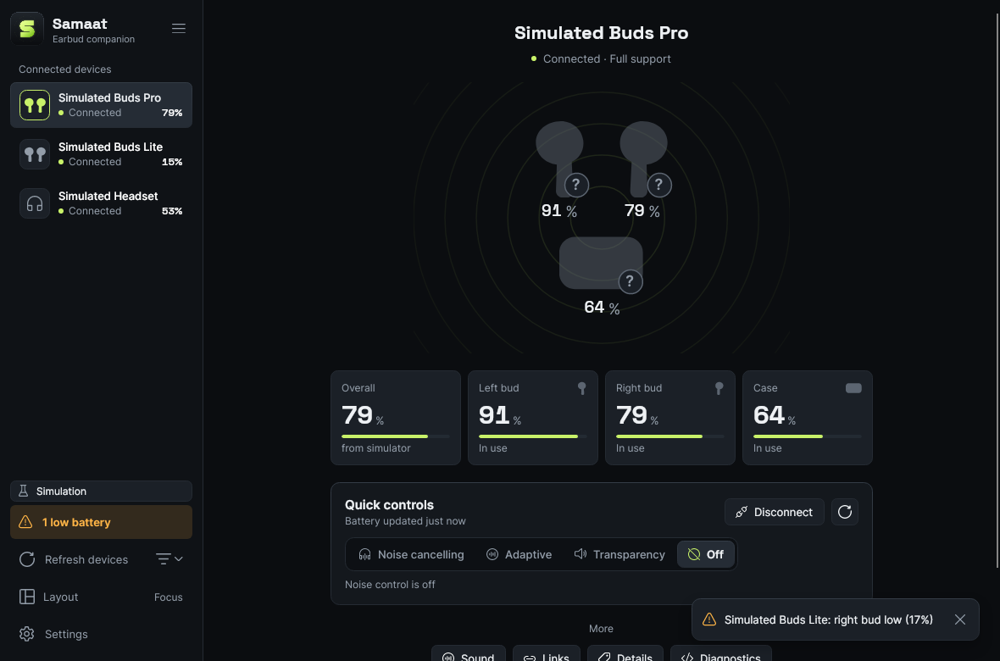 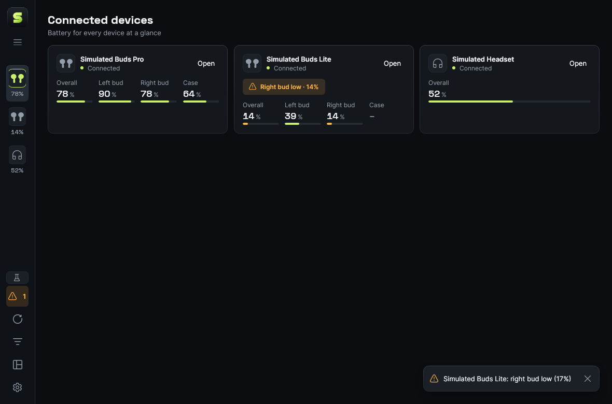 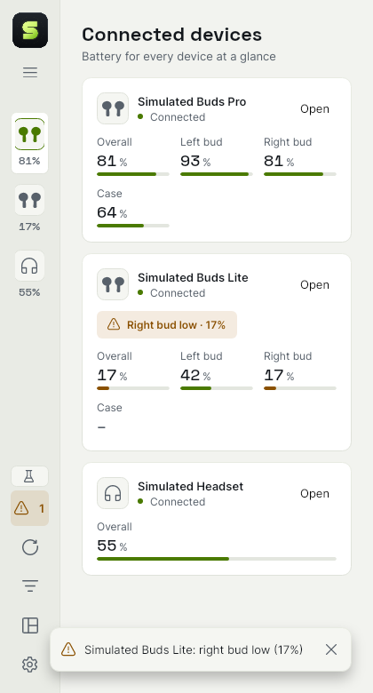 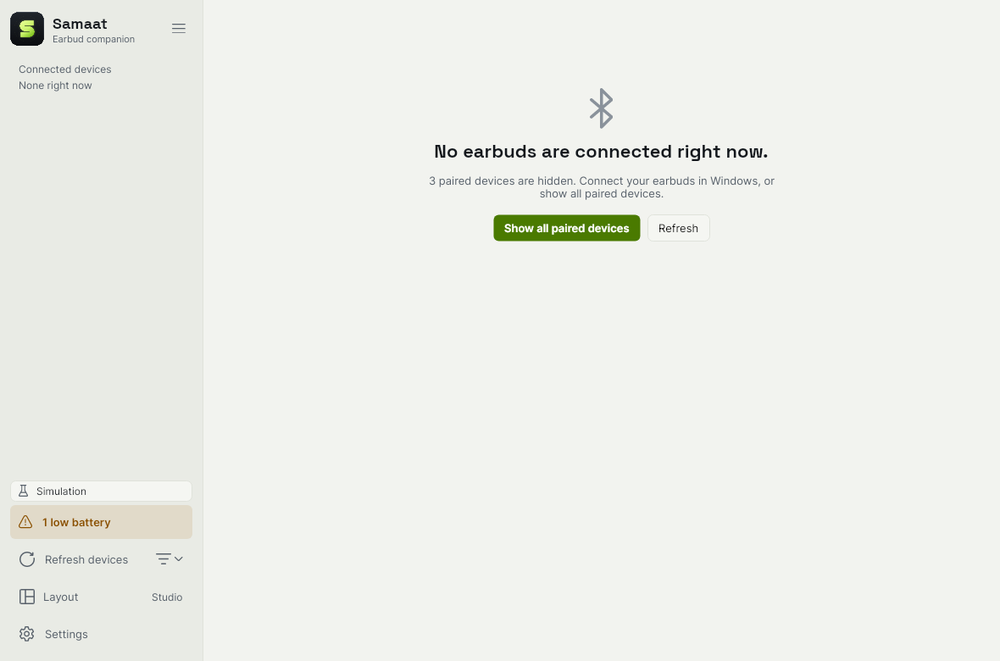

## Design tokens beyond colour (2026-11-05)

Until now only colours were tokens. Radii, the type ramp, hit-target sizes, shadows and the accent swatches were literal values, repeated across 14 files. They had already started to drift: the swatches in Settings repeated `AccentPalette`'s hex values by hand, and every alert message set its own `FontSize="12" FontWeight="SemiBold"`. This round makes the design system the single source of truth for all of them. **No pixels changed**: all 58 dark and light screenshots render identically before and after.

| Before | After | Why |
|---|---|---|
| `CornerRadius="6"`, `"8"`, `"10"` and `FontSize="12"` typed out in styles and views | `Samaat.UI/Styles/Metrics.axaml`: radii (`Samaat.Radius.Control` 6, `Tile` 8, `Panel` 10, plus `Hairline`, `Tab` and `Round20`), the type ramp (`Samaat.FontSize.Label` 11 through `Code` 32), hit targets (`Samaat.Size.Control` 32, `Row` 40, `OptionRow` 48), panel and strip padding, and two shadows (`Samaat.Shadow.Key`, `Overlay`) | Change a value once and the whole app follows. The names say what a value is for, so a new view picks "a control radius", not "6" |
| Swatch ellipses filled with `#C8F169` and friends, a copy of `AccentPalette` | `Samaat.Swatch.Lime`, `Emerald`, `Ice`, `Mono` and `Check`. A test applies each preset and checks that its swatch matches | A new or retuned preset can't leave a stale swatch behind |
| 13 alert and error texts each set their size and weight | `Border.alert TextBlock` sets them. Alerts now only need `Classes="alert"` | One rule per concept, and a new alert can't come out a different size |
| Three "state strips" (Share's "Playing on", Links' state row, the Details adapter note) were each a hand-styled `Border` | `Border.strip` | Same anatomy, same name |
| `Artwork.axaml` (shared with the phone) depended on whatever the host app defined | It merges `Metrics.axaml` itself | The phone app keeps working whether or not it merges the new dictionary |

**Guard rails.** `DesignSystemTests` scans every `.axaml` file in `Samaat.App` and `Samaat.UI`, except the two token dictionaries. A build fails on a hex colour, a literal font size or shadow, or a literal radius that has a token. Round shapes, whose radius is half their size (the 32 px swatch's 16, the hero stage's 14), are geometry, not style, and may stay literal. The test also checks that every metric token resolves in both themes.

**Where values live now.** Theme colours go in `Tokens.axaml`. Anything that doesn't change with the theme goes in `Metrics.axaml`. Component looks are style classes in `Samaat.App/Styles`. Views pick classes and tokens, never raw values.

## Unslop polish pass (2026-11-05)

An audit with the [unslop](https://x.com/heydamir) method (by Damir Sokolovsky, CC BY 4.0) found the app already designed: no gradient surfaces, gradient text, emoji, uppercase labels or looping motion, one icon set, tabular figures and tested contrast. So this was a polish pass inside the existing "Listening room" direction, fixing only what the audit found.

**Direction (unchanged, written down):** a Windows companion that shows battery for each piece, noise control and connections for earbuds from any brand, and says plainly what each pair can't do. Character: exact, candid, quietly technical. World: a listening room at night, ink-black gear with one lime signal light. Moments: the device stage and the battery figures. Signature: the battery ring around each piece.

| Before | After | Why |
|---|---|---|
| A sparkle icon on "Simulation", "Adaptive" and "Reduce motion" | Fluent `beaker`, `sound_wave_circle` and `slide_transition` icons. The Simulation chip's icon is muted instead of amber | A sparkle reads as "AI magic" and says nothing here. Simulation isn't a warning |
| The selected sidebar row and selected options were filled with lime, with a lime border, icon and check on top | The selected row is a raised neutral key with a lit edge, and only its glyph is lime. Selected options, the sharing row, the active host and the chosen layout card are a `Surface2` step with an accent hairline and a check | The accent marks the one thing that matters instead of tinting whole blocks |
| Page titles and the wordmark at weight 700 | 600 | Size carries the hierarchy |
| Diagnostics said "16 of 16" twice | The meter keeps the count; the line under it says only the support tier | One fact, once |
| One-sentence captions ended with a full stop half the time | None do. Text with several sentences keeps its full stops | Captions are labels, not paragraphs |
| Off-grid spacing: alerts 10×6, feature cells 10×8, battery tiles 12×10, tabs 14×0, option rows 8×6, gaps of 6 and 10 | Alerts 12×8 (one line is now 32 px, the height of the buttons beside it), feature cells 12×8, tiles 12, tabs 12×0, option rows and strips 8, gaps of 8 and 12 | Everything sits on the 4 px grid |
| A ⚡ emoji marked charging in the copied report | The word "charging" | No emoji anywhere |

The logo keeps its glow: it is the shipped brand mark. `DesignSystemTests` now also fails on emoji anywhere in `Samaat.App` and on any use of the sparkle icon, and `ContrastTests` checks text and the accent on the new neutral selection surfaces.

**Suggested, not done:** the README's lead screenshot shows the simulated Buds Pro as grey silhouettes with three "?" badges, so the one bright element on screen reads as "unknown". Giving the simulator's devices real artwork would let the device stage be the moment it is designed to be. The overall level also appears four times on the Overview (sidebar, artwork, the figure under the artwork, the Lowest bud tile); dropping the figure under the artwork would remove one, but changes the device rail's layout.

 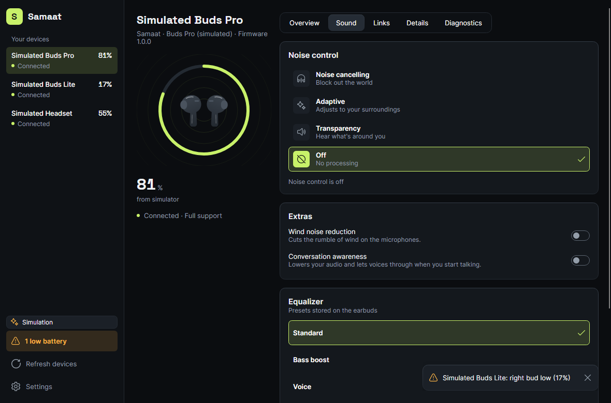 

## Worst-case data and component drawings (2026-11-05)

**Worst-case data.** The simulator gained data sets besides its three tidy demo devices (`SimulatorScenario`). `--simulate=worst` serves four devices built from realistic worst cases, one failure each: an owner-named model ("Aleksandra Wiśniewska-Kowalczyk's Galaxy Buds2 Pro", with every field filled, one bud at 100 %, the other at 1 %, a case it never reports, seven linked hosts with long names and seven EQ presets); a two-letter "Jo" with no model or firmware, one bud flat at 0 % and the other unreported; an Urdu, right-to-left name; and a disconnected Japanese name with an emoji and no reading at all. `--simulate=empty` serves none. `WorstCaseRenderTests` renders every page with both sets, in both themes, at 1180 px and at the 640 px minimum, plus Focus and Glance (420 px), so a crash or binding failure on unusual data fails the build. Set `SAMAAT_STRESS_SCREENSHOTS` to a folder to keep the 87 frames.

What held up: the sidebar truncates long names and shows them in a tooltip; "2 low batteries" pluralises; 0 % and 100 % render with tabular figures; unreported readings show "–" with a reason; Urdu shapes and runs right to left; the emoji renders; seven hosts list with truncated names and tooltips; Glance keeps "Open" reachable at 420 px; the empty state explains itself and offers a way out. What broke, and the fix:

| What broke | Fix |
|---|---|
| Two or three low-battery toasts stacked over the page and hid row buttons (Links' Connect) for 8 s | One toast at a time with "+2 more" under it, and room below the last panel to scroll it clear of the toast |
| A device that never reported a level said "Updated 5s ago" next to "Waiting for a reading", and "– from simulator" | No update time and no source until a level arrives; the rail says "waiting for a reading" or "not reported" |
| "Jo" had no right-bud level, but the caption only mentioned the case | The caption names every piece without a level: "No level from the right bud yet, and the case isn't reported by this device" |
| Truncated names in Focus and audio-output names on Sound had no way to read them in full | Tooltips with the full name |
| A long name wraps to three lines in the device rail | Kept wrapping, with a tooltip: capping it at two lines made Avalonia drop the rest without an ellipsis, so a cut name looked complete |

"Overall" shows the lowest bud (1 % next to a bud at 100 %). Settled 2026-11-06: the tile is now labelled "Lowest bud".

**Component drawings.** [`drawings/list-row-tile-option.html`](drawings/list-row-tile-option.html) ([preview](drawings/list-row-tile-option.png)) is a dimensional drawing of the device row, the figure tile and the option row, measured from the rendered visual tree: every padding, gap, size and radius as a variable, with the formulas that derive the row heights. It records three facts the styles don't show at a glance: rows are taller than their minimum heights because the border and padding add up (54 against 52, and 50 against 48); the device thumbnail's corners (8) are rounder than its row's (6); and tiles flex from 128 px in one to four columns.

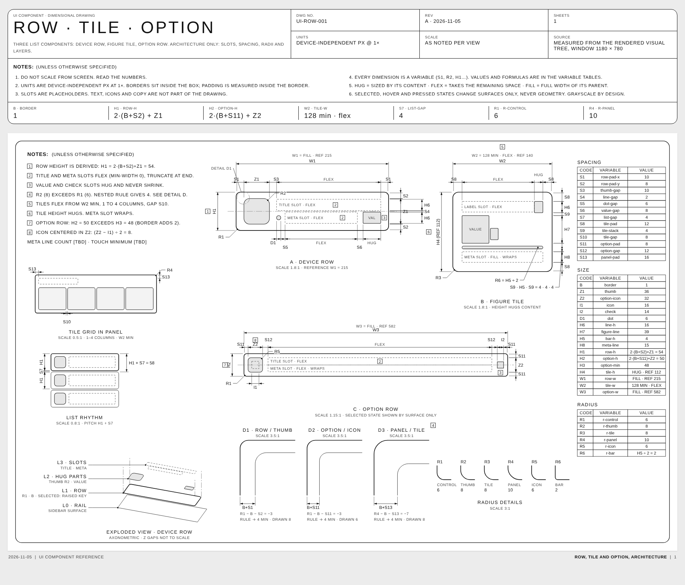

## Motion review (2026-11-05)

A review against Emil Kowalski's animation bar (the `review-animations` skill) blocked on two findings; both are fixed, with the follow-ups.

| Before | After | Why |
|---|---|---|
| Switching tabs cross-faded the page for 180 ms, linear | Tabs switch instantly (`PageTransition="{x:Null}"`; the control's default is a fade) | Tabs change dozens of times a session, and the cross-fade showed two pages overlapping. Motion on a high-frequency action that explains nothing goes |
| The battery ring glided from the previous device's level to the new one when you picked another device | `BatteryRing` drops its transition while its data context changes; level changes for the same device still glide | 81 % → 17 % played as a 260 ms drain that never happened |
| Value glides used the built-in cubic ease-out | A strong ease-out spline (0.23, 1, 0.32, 1), still 260 ms | Lands sooner and crisper, as a dashboard should |
| The busy bar kept sweeping with Reduce motion on, and the level bars kept gliding (the rule in `Gauges.axaml` was overridden by `Controls.axaml`, which loaded later) | `Gauges.axaml` loads last; under Reduce motion the busy bar holds still at half opacity and the level bars jump | Reduced motion removes movement and keeps comprehension; the "Connecting…" text still says what's happening |
| No press feedback | Buttons shrink to 0.97 while held, 160 ms on the same ease-out; none under Reduce motion | A press should feel received |

Held up: layout switching (Ctrl+Shift+1–3) and switches never animate, the disclosure chevron rotates instantly, nothing animates size or position, and the only loop is the busy bar during a real wait.
