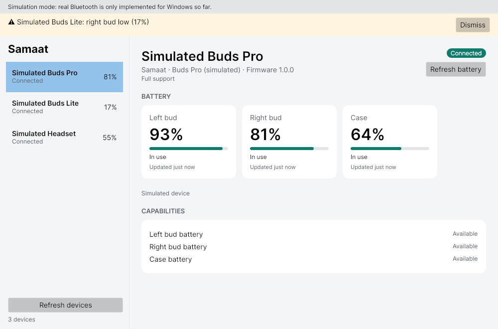

# Module 1: Battery monitoring

Status: **implemented (v0.1)**. The simulator path is tested in CI. The Windows path compiles but has **not yet been run on real hardware**.



## What it does

- Shows left bud, right bud and case levels, or one combined level, depending on what the device reports.
- Shows charging state, where each bud is (in use / in case / not connected), and "updated X ago". Readings older than 5 minutes are flagged as stale.
- Raises low (≤ 20 %) and critical (≤ 10 %) warnings once per crossing. A warning re-arms when the bud charges or rises 5 % above the threshold. Case warnings are opt-in.
- Greys out components the device doesn't report, with a reason:
  - *Not supported by this model*: the source knows the device's full component list (vendor adapter, simulator).
  - *Couldn't detect*: a generic source can't rule out that the component exists (the Windows/OS level, the BLE Battery Service).
  - *Device disconnected*: supported, but not reachable right now. The last value stays visible, marked stale.

## Where battery data comes from

| Source | Components | Tier | Code |
|---|---|---|---|
| Windows (HFP battery reported by the headset) | Combined | Basic | `Samaat.Platform.Windows/OsBatteryFeature.cs` |
| BLE Battery Service 0x180F / 0x2A19, with Presentation Format 0x2904 naming left/right | Combined, or Left + Right | Standard | `Samaat.Protocols.Standard/GattBatteryFeature.cs` |
| Simulator (3 devices, one per layout) | all three layouts | – | `Samaat.Simulator/` |
| Vendor adapter (L/R/case over RFCOMM) | Left, Right, Case | Full | **Not yet: needs the first target earbuds (PLAN §13 Q1)** |

Every source implements `IBatteryFeature` (`Samaat.Core/Battery/IBatteryFeature.cs`). The UI and the alerts only see that interface, so a vendor adapter plugs in without UI changes.

## Running it

```bash
# Simulator (any OS)
dotnet run --project src/Samaat.App -f net10.0
dotnet run --project src/Samaat.Cli -f net10.0 -- --simulate --watch

# Real Bluetooth (Windows 10 2004+ / Windows 11)
dotnet run --project src/Samaat.App -f net10.0-windows10.0.19041.0
dotnet run --project src/Samaat.Cli -f net10.0-windows10.0.19041.0 -- --watch
#   --all-devices   also list paired non-audio devices
#   --simulate      add the simulated devices alongside real ones
```

## Windows hardware checklist (first run)

Run `samaat-cli --watch` with your earbuds paired and connected, and compare it with Settings › Bluetooth & devices:

1. Are your earbuds listed? If not, try `--all-devices`. The Class of Device filter may be excluding them.
2. Does the battery match what Windows shows? This checks the `{104EA319-…} 2` property lookup through the container ID.
3. Does the value update when the level changes, and after you disconnect and reconnect?
4. If your earbuds also have a BLE side with the Battery Service, does the tier show **Standard**, and do left/right appear?

Please send the output back. These are the unverified assumptions in this module.

## Known limitations

- The Windows battery value is a single level. Windows doesn't expose separate left, right or case levels.
- A device that starts reporting battery only after Samaat started is picked up on the next **Refresh devices**.
- LE-Audio-only devices with no Classic side aren't listed yet.
- No system tray icon or OS notifications yet. Alerts show as an in-app banner (planned for Phase 3).
