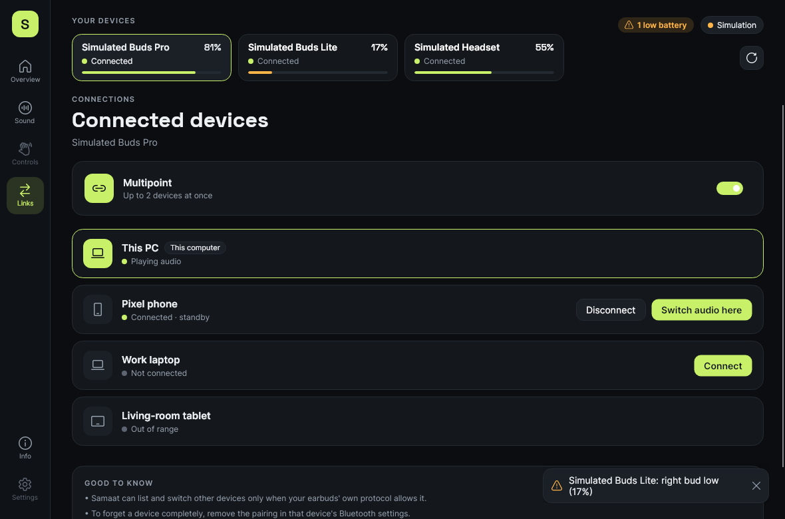
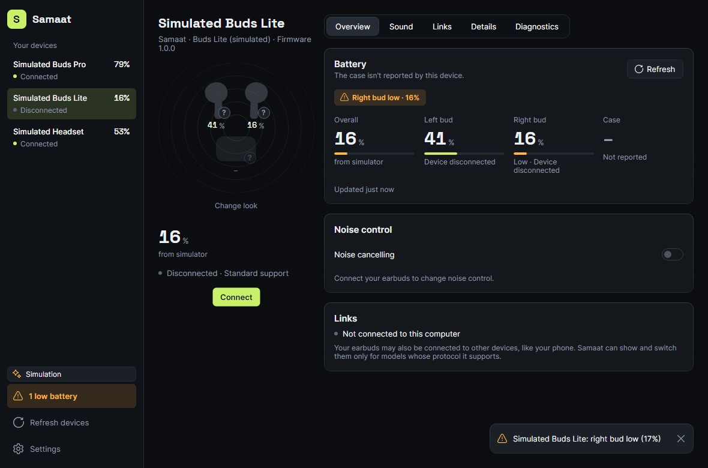

# Module 3: Multipoint and connected devices

Status: **implemented (v0.2), plus connect and disconnect for this computer (needs a hardware check)**. Tested end to end with the simulator. Real devices show only "this computer" until a vendor adapter exposes multipoint.

## What it does

- Lists every host the earbuds know: **playing audio, connected on standby, not connected, out of range**. The active host is listed first and "This computer" is marked.
- **Switch audio here / Connect**: makes a host the audio source, connecting it first if needed. When the connection limit is reached, the standby host is dropped (never this computer, if there's a choice).
- **Disconnect** another host. Disconnecting *this* computer is refused with guidance to use system Bluetooth settings, because Samaat would lose its control channel.
- A **multipoint switch**. Turning it off drops standby hosts.
- The same confirm-or-roll-back behaviour as noise control.
- When the device has no multipoint support in Samaat, the page shows only this computer's link and says why other devices can't be seen.
- The limits from PLAN.md §8 are always stated on the page.

## Code

| Piece | Where |
|---|---|
| Hosts, options, state, `IMultipointFeature`, capabilities | `src/Samaat.Core/Connections/Multipoint.cs` |
| `MultipointRules`: reference model of switching, disconnecting and toggling | same file |
| Simulated device | `src/Samaat.Simulator/SimulatedMultipoint.cs` |
| View models | `src/Samaat.App/ViewModels/ConnectionsViewModel.cs` |
| Page | `src/Samaat.App/Views/ConnectionsPage.axaml` |

## Connect and disconnect

The **This computer** row on the Links page has a **Connect** / **Disconnect** button. **Connect** also sits under the status line of a disconnected device, and the tray menu has one "Connect {name}" or "Disconnect {name}" item per device. All three use the same two commands on `DeviceViewModel`, which allow one link operation at a time and report failures on the toast list (and inline on the Links page).

- **Windows** (`BluetoothAudioLink`): sends the one-shot `KSPROPSETID_BtAudio` property (reconnect 0, disconnect 1) that Windows Settings uses, to every Bluetooth audio filter (A2DP and hands-free) behind the device's audio endpoints. The endpoints are found by container id. Connect waits up to 15 s for the device to show as connected, disconnect up to 10 s. This is undocumented for apps; if it stops working the fallback is a link to `ms-settings:bluetooth`.
- **No audio endpoint** (or a non-Windows source): no buttons; the row says "Use Windows Bluetooth settings to connect this device." with an **Open Bluetooth settings** button.
- **Simulator**: every simulated device can be disconnected and connected again.
- Samaat can lose its control channel while the device is disconnected, so battery and settings stay stale until it returns.

Code: `Samaat.Core/Connections/PcLink.cs` (`IPcLinkFeature`, `AwaitStateAsync`, `SendToAll`), `Samaat.Platform.Windows/BluetoothAudioLink.cs`, `Samaat.Simulator/SimulatedPcLinkFeature.cs`. Tests: `PcLinkTests.cs` (Core) and `PcLinkViewModelTests.cs` (App).

## Tests

`MultipointTests.cs` in Core.Tests (rules, capabilities, simulator) and `ConnectionsViewModelTests.cs` in App.Tests.

## Not yet

- Any real device (needs a vendor adapter).
- Connect and disconnect from this computer is built but has not run on hardware yet; see the checklist in docs/plans/2026-11-04-pc-connect.md.
- Moving earbuds to a phone running Samaat now works with any earbuds, through the computer's connect and disconnect: see [phone-handoff.md](phone-handoff.md).
