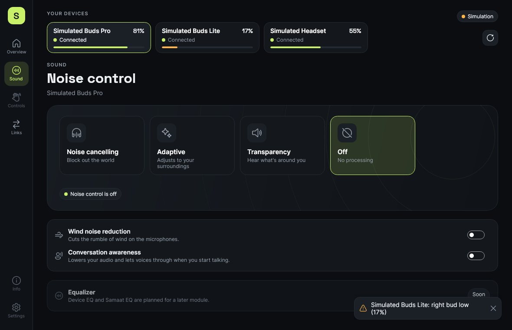

# Module 2: Noise control

Status: **implemented (v0.2)**. Tested end to end with the simulator. No real device can be controlled yet: that needs the first vendor adapter.

## What it does

- Modes: **Noise cancelling, Adaptive, Transparency, Off**, whichever the device reports.
- The UI is built from the device's options, following the table in PLAN.md (Module 2):

  | Device reports | UI |
  |---|---|
  | No modes (or no adapter) | Greyed-out card with the reason |
  | Off + noise cancelling only | A single on/off switch |
  | Several modes | One card per mode, plus quick chips on Overview |
  | ANC strength range | Strength slider, shown while noise cancelling is on |
  | Ambient level range | Ambient slider, shown while Transparency is on |
  | Wind reduction / conversation awareness | Switches |

- **Writes are confirmed.** A change shows immediately. If the device refuses it or doesn't confirm within 3 s, the UI rolls back to what the device last reported and explains why.
- **Sliders send only the latest value** (`LatestValueSender`). Dragging from 10 to 0 sends two commands, not eleven.
- Changes made **on the earbuds** (e.g. a long press) are reflected in the UI.

## Code

| Piece | Where |
|---|---|
| Modes, options, state, `INoiseControlFeature`, capabilities, layout rules | `src/Samaat.Core/NoiseControl/NoiseControl.cs` |
| `CommandResult`, `CommandRunner` (timeout), `LatestValueSender` | `src/Samaat.Core/Commands/` |
| Simulated device behaviour (latency, injected failures) | `src/Samaat.Simulator/SimulatedNoiseControl.cs`, `SimulatedCommandChannel.cs` |
| View model (optimistic update + rollback) | `src/Samaat.App/ViewModels/NoiseControlViewModel.cs` |
| Page | `src/Samaat.App/Views/SoundPage.axaml` |

## Tests

`NoiseControlTests.cs`, `CommandRunnerTests.cs` and `LatestValueSenderTests.cs` in Core.Tests, and `NoiseControlViewModelTests.cs` in App.Tests.

## Not yet

- Any real device. A vendor adapter implements `INoiseControlFeature` over its protocol, and the UI needs no changes.
- Equalizer (planned as its own module).
