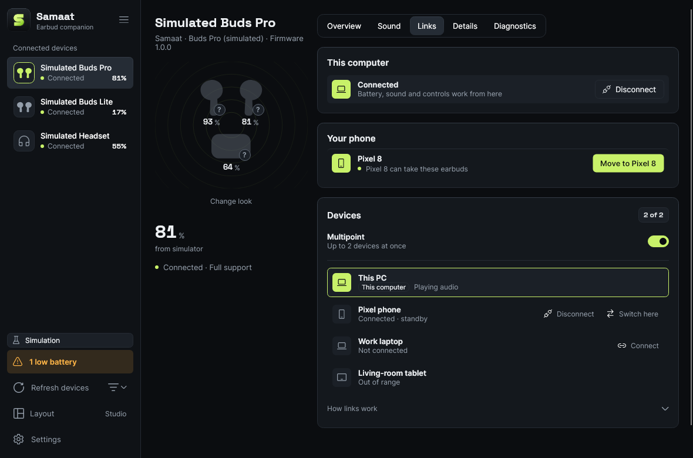
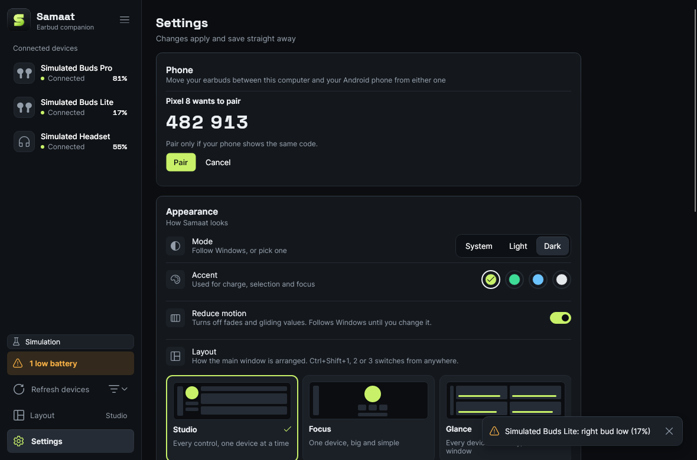

# Module: Move earbuds between this computer and a phone

Status: **implemented, not yet run on hardware.** Tested end to end in CI: pairing, the encrypted link and moves both ways over real TCP, with simulated earbuds on both sides. The Android app type-checks against the real Android APIs and its APK is built by CI; nobody has installed it on a phone yet.

| Computer: Links page | Computer: pairing | Phone: earbuds | Phone: pairing |
|---|---|---|---|
|  |  |  |  |

## What it does

- **Any earbuds, even ones that connect to one device at a time.** Samaat runs on both devices and moves the earbuds with each OS's own connect and disconnect. No vendor protocol is needed.
- **Pair once**, like Bluetooth: Settings → Phone → **Pair a phone** on the computer, **Pair with a computer** on the phone, check that both show the same 6-digit code, and tap **Pair** on both.
- **Move from either side.** On the computer's Links page: **Move to {phone}** and **Bring back here**. On the phone's earbuds page: **Move to {computer}** and **Bring to this phone**. Progress shows live on both screens.
- **Never stranded.** The computer coordinates every move. It checks the other side first, releases the earbuds on one device, and asks the other to connect them. If that doesn't happen in time, it connects them back where they were.
- The phone app also shows battery, noise control and EQ presets with the desktop's drivers and protocols (the `devices/` catalog, Jieli RCSP, Fast Pair, then the BLE Battery Service, then Android's own level), and the desktop's artwork: the model photos from `devices/`, the split left/right/case photos, the "?" looks and **Change look**.

## How a move works

```
Computer (coordinator)                      Phone
  Prepare(address) ───────────────────────▶  Bluetooth on? Earbuds paired here? Permission?
                   ◀─────────────────────── Ready / Refused(reason)        nothing has changed yet
  Disconnect here (IPcLinkFeature)
  ConnectAudio(address) ──────────────────▶  hidden connect → else ask the user (one tap)
                   ◀─────────────────────── Confirmed once A2DP/HFP is connected
  if not confirmed in 60 s: connect here again (rollback)
```

Moving to the computer is the mirror image: the phone releases, the computer connects, and the phone takes them back if that fails. A move started on the phone sends `StartHandoff` to the computer, which runs the same steps. Outcomes: **Moved**, **NotStarted** (refused before anything changed), **RolledBack**, and **Stranded** (the rollback failed too; the message says what to do).

## Android limits

Android has no public API that lets an ordinary app connect or disconnect a headset. So the phone:
1. tries the hidden `BluetoothA2dp`/`BluetoothHeadset` `connect`/`disconnect` through reflection (works on older Android and some phones),
2. then asks the user: with the app open it shows Android's output switcher (Android 14+), the media output panel (10–13) or Bluetooth settings; in the background it posts a notification,
3. and confirms only once Android reports the profile as connected or disconnected.

Each attempt is recorded (`AndroidPhoneAudio.LastAttempt`), so the hardware check can note which phones need the tap. iOS doesn't let apps do either, so there is no iOS app.

## Security

- Pairing is ECDH P-256 with a commitment, compared with a 6-digit code (Bluetooth's numeric comparison). A man in the middle gets different codes on the two screens unless he guesses one in a million.
- Every session derives fresh AES-256-GCM keys (one per direction) from the paired secret and two nonces. Frames use counter nonces, so tampered, replayed or reordered frames close the connection.
- The computer stores secrets in `phones.json` next to `settings.json`, encrypted with DPAPI. Outside Windows (the simulator build) they are stored as they are, in a file only its owner can read or write (0600). The phone keeps them in the app's private storage.
- The computer listens on TCP 47821 only while a phone is paired or pairing is open. Windows asks once to let Samaat through the firewall.
- The UDP beacon (port 47820), which carries the computer's name in the clear, goes out **only while pairing is open**. A paired phone dials the address and port it stored when it paired or last connected. If the computer's address changes, opening "Pair a phone" on the computer for a moment lets the phone find it again without pairing again.
- At most 4 connections may be in their handshake at once (`PhoneLinkHostOptions.MaxPendingHandshakes`); more are closed straight away.
- A pairing whose handshake was still running when pairing closed is dropped, with no prompt on the computer.

Full protocol: [docs/plans/2026-11-04-phone-handoff.md](../plans/2026-11-04-phone-handoff.md).

## Code

| Piece | Where |
|---|---|
| Messages, framing | `src/Samaat.Handoff/Protocol/` |
| Key derivation, AES-GCM, pairing keys | `src/Samaat.Handoff/Security/Crypto.cs` |
| Pairing and session handshakes | `src/Samaat.Handoff/Pairing/Handshake.cs` |
| Encrypted channel (request/reply, keep-alive) | `src/Samaat.Handoff/Link/PeerChannel.cs` |
| Move logic and rollback; the phone's side | `src/Samaat.Handoff/Moving/HandoffCoordinator.cs`, `PhoneAgent.cs` |
| Computer host, phone client, beacon, paired devices | `src/Samaat.Handoff/PhoneLinkHost.cs`, `PhoneLinkClient.cs`, `Discovery/`, `Storage/` |
| Desktop UI | `src/Samaat.App/Features/Phone/`, Settings and Links pages |
| Phone UI, Android platform layer and app, phone preview | the **[samaat-mobile](https://github.com/MuhammadAbdulMoiz/samaat-mobile)** repo (`src/Samaat.Mobile`, `Samaat.Platform.Android`, `Samaat.Android`, `Samaat.Mobile.Preview`), which builds this repo's shared projects from a submodule |

## Tests

- `Samaat.Handoff.Tests` (99): crypto (tamper, replay, reorder, wrong key), framing, every message type, pairing (codes match, decline, commitment mismatch), sessions, every coordinator path including timeouts, the phone agent, and loopback end-to-end (pair, move both ways, rollback, forget, the computer restarting).
- `Samaat.App.Tests`: the Links card states, and the desktop paired with a real phone client over loopback, moving both ways, plus screenshots.
- `Samaat.Mobile.Tests` (18, in samaat-mobile): the phone UI against a real computer host, accessibility checks (44 px targets, names, colour pairs, low battery in words), plus phone-sized screenshots.
- Android: compiled and packaged by samaat-mobile's CI (`android` job). Hardware: the checklist in the plan.

## Trying it and building the Android app

See [docs/TRY-IT.md](../TRY-IT.md) and the **[samaat-mobile](https://github.com/MuhammadAbdulMoiz/samaat-mobile)** repo: the phone app in a window on a laptop (pairs with the desktop over the real network), and the Android APK (built by samaat-mobile's CI, or locally with the Android workload). The APK is signed with the debug key, which is fine for testing but not for a store.

## Known limits

- Not run on real phones yet. The Android connect strategies are the least certain part.
- Both devices must be on the same network, and some guest or office Wi-Fi blocks devices from reaching each other. There is no relay over the internet and no Bluetooth fallback between the phone and computer yet.
- The phone pairs with one computer at a time. The computer can pair with several phones.
- Android hides vendor and product IDs from apps, so on the phone models are matched by name and services only.
